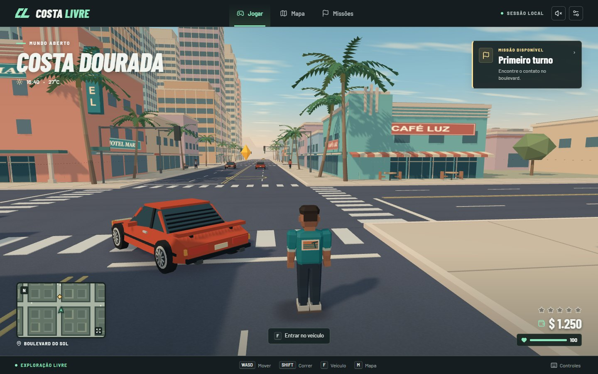

# Costa Livre

Jogo de mundo aberto para navegador, em português. Você começa no boulevard de Costa Dourada com $ 1.250, um cupê coral estacionado à frente e um contato esperando depois do cruzamento.



## Instalação e execução

Use Node.js 22.12 ou superior e um navegador com WebGL 2 e aceleração gráfica. O projeto foi testado com Node.js 24 e Chromium. Na pasta do projeto, execute

```sh
npm ci
npm run dev
```

Abra o endereço **Local** exibido pelo Vite. A cidade carrega diretamente na tela de jogo. Em máquinas com GPU integrada, abra o ícone de configurações e selecione **Econômica** para reduzir a resolução e desligar as sombras dinâmicas.

Para conferir a distribuição de produção, execute

```sh
npm run build
npm run preview
```

A pasta gerada `dist/` pode ser servida por um servidor de arquivos estáticos. Fontes, geometrias, materiais e o módulo de física carregam localmente. O jogo roda em uma sessão individual. Recarregar a página reinicia a campanha e o dinheiro.

## Começar a jogar

1. Pressione **F** ao lado do cupê coral para assumir o volante.
2. Siga até o losango dourado no boulevard. O minimapa mostra o objetivo e **M** abre a cidade inteira.
3. Pressione **E** perto do marcador para aceitar **Primeiro turno**. O cartão superior indica o próximo objetivo e o prazo.
4. Entre nos círculos de coleta e entrega com o cupê abaixo de **13 km/h**. A recompensa entra na carteira e o novo contato aparece no mapa.

## Controles

| Entrada          | A pé                                 | No cupê                              |
| ---------------- | ------------------------------------ | ------------------------------------ |
| W / S ou ↑ / ↓   | Avançar / recuar                     | Acelerar / frear e engatar ré        |
| A / D ou ← / →   | Deslocar para os lados               | Esterçar                             |
| Shift            | Correr                               | —                                    |
| Espaço           | Saltar                               | Freio de mão                         |
| F                | Entrar no cupê próximo               | Sair por um espaço livre             |
| E                | Aceitar missão perto do contato      | Aceitar missão perto do contato      |
| Arrastar na cena | Girar câmera                         | Girar câmera de perseguição          |
| M                | Abrir ou fechar mapa                 | Abrir ou fechar mapa                 |
| H                | Consultar controles                  | Consultar controles                  |
| Esc              | Abrir configurações ou fechar painel | Abrir configurações ou fechar painel |

Os painéis pausam a simulação e o cronômetro das missões. O botão de áudio ativa o motor e os sinais de notificação sintetizados. Dispositivos de toque têm controles direcionais e botões de ação na tela.

## Cidade e simulação

- **36 quadras e 49 cruzamentos.** As vias conectam Costa Dourada, Centro Financeiro, Vila das Flores, Porto Industrial, Orla do Sol e a Via Costeira. A geração usa uma semente fixa para manter os trajetos reproduzíveis.
- **Exploração em terceira pessoa.** O personagem usa uma cápsula física, animação de braços e pernas e câmera com teste de obstrução.
- **Cupê dirigível.** Carroceria dinâmica com suspensão simplificada por mola e amortecedor, aderência lateral, marcha à ré, freio de mão e colisões. O cupê coral pertence ao jogador. Os demais veículos seguem rotas de IA.
- **Trânsito e pedestres.** 17 carros percorrem a malha viária. 24 pedestres circulam pelas calçadas, desviam uns dos outros e reagem a veículos próximos e perseguições.
- **Polícia e vida.** Colisões em velocidade com veículos e atropelamentos geram estrelas. A resposta aumenta até cinco viaturas. Abra mais de 45 metros de distância de todas elas e mantenha a vantagem até o alerta cessar. Impactos e contato com viaturas reduzem a vida. Ao chegar a zero, o jogador retorna ao boulevard e paga até $ 100 pelo atendimento.
- **HUD.** O mapa indica posição, direção, veículos e objetivo. A interface exibe vida, saldo, estrelas, bairro, velocidade, notificações e tempo de missão.

## Campanha

| Missão           | Percurso                                                                             | Prazo | Recompensa |
| ---------------- | ------------------------------------------------------------------------------------ | ----- | ---------- |
| Primeiro turno   | Aceitar a chamada no boulevard, coletar a encomenda e estacionar na entrega          | 135 s | $ 450      |
| Expresso da orla | Recolher a carga no litoral, passar pelo posto de conferência e entregar             | 100 s | $ 850      |
| Última saída     | Retirar a carga, escapar de uma perseguição de duas estrelas e estacionar no refúgio | 180 s | $ 1.400    |

Esgotar o prazo ou precisar de atendimento durante a missão devolve o objetivo ao contato inicial. Missões concluídas permanecem pagas na sessão. Após a última entrega, a exploração continua livre.

## Código-fonte

| Módulo                         | Responsabilidade                                                            |
| ------------------------------ | --------------------------------------------------------------------------- |
| `src/main.ts`                  | Inicialização, entrada, painéis, HUD e loop de simulação de passo fixo      |
| `src/world.ts`                 | Geração procedural, iluminação, materiais, edifícios, vegetação e colisores |
| `src/actors.ts`                | Modelagem original do cupê e personagens, física do jogador e câmeras       |
| `src/systems.ts`               | Trânsito, pedestres, polícia, dano, recuperação e campanha                  |
| `src/map.ts`                   | Cartografia 2D, minimapa e marcadores                                       |
| `src/sound.ts`                 | Síntese de áudio local                                                      |
| `index.html` e `src/style.css` | Estrutura e apresentação da interface                                       |
| `tests/`                       | Testes de integração com Playwright, Three.js e Rapier                      |

A geometria estática usa instâncias agrupadas por região. Peças rígidas dos personagens e dos carros compartilham geometrias. O Rapier simula a 60 passos por segundo e o renderizador desenha os quadros disponíveis. Os modelos, letreiros e materiais da cidade são gerados pelo projeto. A interface usa fontes Barlow e ícones Lucide.

## Verificação

```sh
npx playwright install chromium
npm test
```

O Playwright inicia o Vite automaticamente ou reutiliza o servidor local na porta 5173. Os testes verificam

- **Controles e interface.** Carregamento WebGL, mapa, missões, qualidade gráfica, áudio, ajuda, corrida, salto, entrada, aceleração, frenagem e saída do cupê.
- **Percurso integral.** Um motorista automatizado produz comandos de aceleração, direção e freio nos mesmos controles da simulação. Percorre os três itinerários, despista a polícia na última missão e verifica o saldo final de $ 3.950.
- **Condições de borda.** Uma simulação controlada exercita o prazo esgotado, o reinício, as recompensas, os contatos físicos, cinco níveis de procura e a perda das estrelas.

